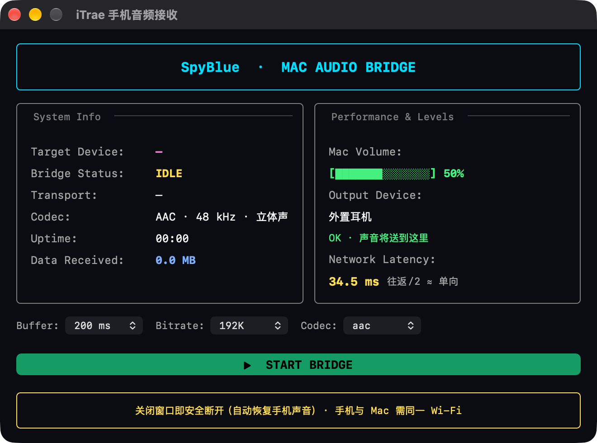

# iTrae 手机音频接收

> 把 Android 手机的系统声音实时送到 Mac 播放 —— 走 ADB（Wi‑Fi 或 USB），不依赖蓝牙。
> 单窗口 GUI，一个按钮开关，可在界面上调音频缓冲 / 码率 / 编码。



---

## 为什么不用蓝牙？

macOS 的蓝牙栈**不提供 A2DP Sink（接收端）**角色：系统设置里只有"输出"，没有"输入"，Mac 无法作为蓝牙音箱被手机连接。GitHub 上唯一的 macOS 方案
`airander/A2DP-SINK` 早在 2014 年就归档且只接收 RTP 包、不做解码。

所以在 macOS 上接收 Android 音频，可行路径是 **ADB + scrcpy 的音频采集能力**：手机端用 Android 的
`AudioPlaybackCapture`（Android 11+）抓取系统混音，编码后经 adb 传到 Mac 播放。

## 特性

- **单窗口 App**：状态、输出设备、实测网络延迟、音频参数集中在一个界面里
- **一键开关**：START / STOP，关闭窗口即安全断开
- **参数可调**：音频缓冲 50/100/200/350/500 ms、码率 96/128/192 kbps、编码 opus/aac/flac/raw（会记住选择）
- **真实延迟测量**：定时 `ping` 手机，显示 WiFi 往返 RTT（颜色分档）
- **自动恢复手机声音**：启动/停止/关窗都会清理手机端残留的 `scrcpy-server` 进程，避免"电脑关了手机反而没声音"
- **自动找设备**：优先 USB，其次用记住的 IP 走无线；失效会自动重启 adb 服务重试

## 推荐设置（实测验证）

> **5GHz Wi-Fi、手机靠近路由器时，推荐：**
>
> | Buffer | Bitrate | Codec |
> |---|---|---|
> | **200 ms** | **192K** | **raw** |
>
> 实测该组合流畅、无电流声（`raw` 为无损 PCM，不产生编码伪影；带宽约 1.5 Mbps，5GHz 完全够用）。

其他环境：

| 环境 | Buffer | Bitrate | Codec |
|---|---|---|---|
| Wi-Fi 一般 / 有卡顿 | 500 ms | 128K | opus |
| 2.4GHz / 弱信号 | 500 ms | 96K | opus |
| 最稳（任何网络） | 200 ms | 192K | aac + **USB 直连** |

## 工作原理

```
手机 (Android 11+)
  └─ AudioPlaybackCapture → 编码 (opus/aac/flac)
        │  adb (USB 或 TCP/IP 5555)
        ▼
Mac: scrcpy --no-video --no-control --no-window
        └─ 解码 → 交给默认输出设备（耳机 / 内置扬声器）
```

> 界面本身不播放音频，真正出声的是 scrcpy 进程；App 只负责启动/停止、参数与环境（`ADB` 路径）管理。

## 环境要求

| 项目 | 要求 |
|---|---|
| Mac | macOS 13 及以上（本项目按 `arm64-apple-macos13.0` 编译，Intel 机器改一下自己的 `-target` 即可） |
| 手机 | Android 11+，已开启「开发者选项 → USB 调试」（无线还需「无线调试」） |
| scrcpy | 5.x（开发时使用 [scrcpy 5.0.1 macOS arm64](https://github.com/Genymobile/scrcpy/releases)） |
| adb | Android platform-tools 里的 `adb`（scrcpy 自带一份也可用） |

## 安装

### 方式一：自己构建（推荐）

```bash
git clone https://github.com/wangpengcheng1234-jpg/mac-android-audio-bridge.git
cd mac-android-audio-bridge

# 1. 下载 scrcpy 5.x（macOS arm64），解压到 ./scrcpy/ 目录，保证存在：
#    ./scrcpy/scrcpy-macos-aarch64-v5.0.1/scrcpy
#
# 2. 构建（需要 Xcode Command Line Tools 里的 swiftc）
./scripts/build.sh

# 3. 产物：dist/iTrae 手机音频接收.app，拖进 /Applications 即可
```

App 会按以下顺序查找 scrcpy：`UserDefaults 里的 scrcpyDir` → `App/Contents/Resources/scrcpy` →
`~/scrcpy/scrcpy-macos-aarch64-v5.0.1` → `~/Downloads/scrcpy-macos-aarch64-v5.0.1`。

### 方式二：直接用已构建的 App

把 App 放进 `/Applications`，首次启动允许「查找本地网络中的设备」。

## 使用

1. 手机上开启「开发者选项」和「USB 调试」。
2. **先用 USB 连一次**（这一步最省事）：`adb devices` 能看到设备后，打开 App 点 `START BRIDGE` 就能出声。
3. 想走无线：

```bash
adb tcpip 5555                     # 切到 TCP/IP 模式
adb connect <手机IP>:5555          # 例如 192.168.1.20:5555
```

之后拔掉 USB，App 里点 `START BRIDGE` 即可（首次会弹窗让你填手机 IP，成功后会记住）。

> 手机与 Mac 需要在同一个 Wi‑Fi；建议 5GHz、靠近路由器、手机别息屏/别开省电模式。

## 界面与参数

| 区域 | 内容 |
|---|---|
| System Info | 目标设备、桥接状态、传输方式（USB / Wi‑Fi）、编码、运行时长、已接收量（估算） |
| Performance & Levels | Mac 音量、当前输出设备（疑似蓝牙音箱时会提示）、实测网络延迟 RTT |
| 参数行 | `Buffer` / `Bitrate` / `Codec`，传输中锁定，改动在下次 START 生效 |

**数据是估算的**：`Data Received` 按运行时长 × 16 KB/s 推算，不是真实字节数；`Network Latency` 才是实测值
（`ping -c 2` 的平均往返时间）。

### 卡顿 / 电流声怎么调

| 症状 | 建议 |
|---|---|
| 卡顿、断续 | `Buffer` 调到 350–500 ms；仍卡就改用 **USB**（最稳） |
| 滋滋/电流声 | `Codec` 换 `raw`（无损 PCM，彻底无编码伪影）；带宽不够再退回 `aac` + 192K |
| 延迟忽高忽低 | 看 `Network Latency`；换 5GHz、靠近路由器、关闭手机省电 |

## 常见问题

**点 START 提示"未找到手机"**
手机不在线或无线调试没开；App 会自动重启 adb 服务重试一次，仍失败就用 USB 连一次或重新
`adb connect`。

**关闭程序后手机没声音**
旧版 scrcpy 被强杀时机端的 `scrcpy-server` 会残留并继续占用音频路由。本项目已处理：启动、停止、
关窗都会清理残留；若遇到，可手动执行：

```bash
adb shell ps -A -o PID,ARGS | grep scrcpy
adb shell kill -9 <PID>
```

**手机音量条上还是"手机喇叭"图标**
这是方案固有限制，不是 bug：Mac 不是手机的音频输出设备，Android 仍按本机扬声器路由，抓的是系统混音。
功能不受影响（声音照样会到 Mac）。

**需要 macOS 权限吗？**
只需要首次启动时的「本地网络」授权（用于连手机）。不需要录屏、麦克风或辅助功能权限。

## 隐私

- 不采集、不上报任何数据；没有遥测/联网回传。
- 唯一的网络行为是**本机 adb 连接你的手机**，以及 `ping` 手机 IP 测延迟。
- 手机 IP、音量、编码参数只保存在本机 `UserDefaults`（`local.macaudio.phone`）。

## 代码来源与致谢

本项目**没有复制**任何第三方源码，只通过命令行调用外部程序；界面为自绘 AppKit 代码。

| 来源 | 作用 | 许可 |
|---|---|---|
| [Genymobile/scrcpy](https://github.com/Genymobile/scrcpy) | 音频采集与传输的实际执行者（本仓库不包含其二进制，由使用者自行下载） | Apache License 2.0 |
| [Android platform-tools (adb)](https://developer.android.com/tools/releases/platform-tools) | 设备连接、TCP/IP、音频音量与进程管理 | Android SDK 相关许可（Apache 2.0 等） |
| [spyalekos/spyblue](https://github.com/spyalekos/spyblue) | **仅参考**其终端仪表盘的配色与布局风格（cyan/dim/yellow 描边、`█░` 方块条、Panel 标题） | 原仓库未声明许可证，因此本项目未使用其任何代码 |
| 图标 | 本项目自绘（深色圆角 + 手机轮廓 + 声波） | 随本项目 MIT |

若你是上述项目的作者并认为有不妥之处，请开 issue，我会调整。

## 许可证

[MIT](LICENSE) © 2026 iTrae

## 免责声明

仅供个人学习与自用。使用 scrcpy 的音频采集依赖 Android 的 `AudioPlaybackCapture`，
部分 App（带 DRM 或明确禁止采集）可能无声；请遵守当地法律与各 App 的服务条款。
